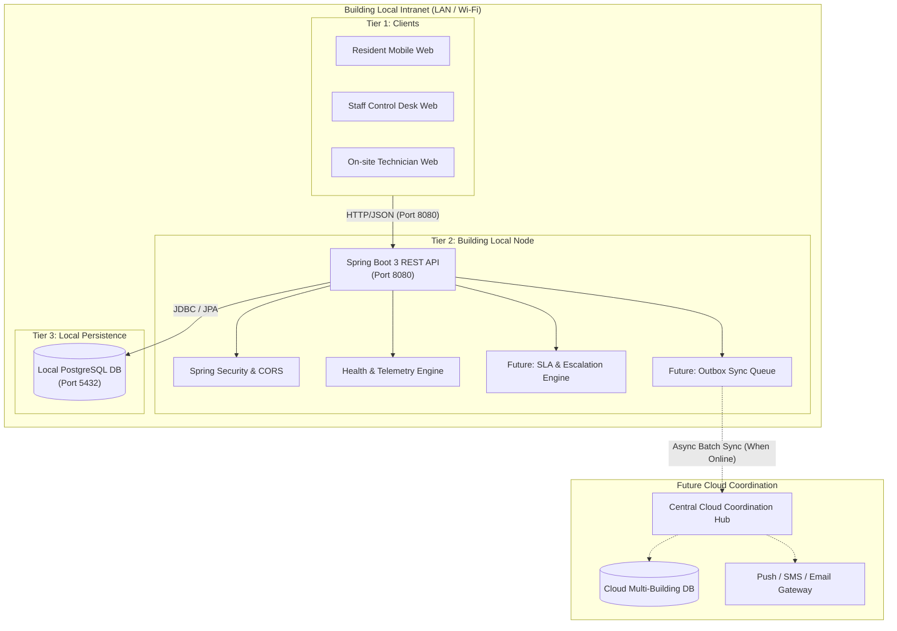

# LiftCare System Architecture

## 1. System Vision & Objective

**LiftCare** is an offline-first elevator issue management and automatic escalation system engineered specifically for residential complexes, commercial office towers, and hospital facilities. 

In conventional cloud-only facilities software, an internet outage renders the elevator incident desk inoperable. When an elevator stalls or an emergency entrapment occurs during network downtime, residents cannot report issues, security staff receive delayed alerts, and technician dispatch SLAs are breached without an audit trail.

LiftCare resolves this vulnerability through a **Local-First, Cloud-Coordinated Architecture**:
- Each building operates an **on-premise local server and database** on the building's local area network (LAN/Wi-Fi).
- Even during total external internet disconnects, building residents, security guards, and onsite technicians can access the local web portal, file emergency issues, view real-time elevator status, and trigger local SLA countdowns.
- When internet connectivity is present or restored, the local appliance asynchronously synchronizes records with a central cloud coordination server.

---

## 2. Multi-Tier Architectural Topology

---

## 3. Core Architectural Components

### 3.1. Tier 1: React + Vite Frontend
- **Technology**: React 18, Vite, React Router, Modern Responsive CSS.
- **Role**: Responsive web interface accessible on desktop and mobile browsers over building Wi-Fi or Ethernet.
- **Characteristics**:
  - Communicates with the local server via a configurable base URL (`VITE_API_BASE_URL`).
  - Implements lightweight health checking, visual status indicators, and offline state awareness.
  - Zero requirement for external CDNs; all JavaScript and style bundles are served locally.

### 3.2. Tier 2: Building-Local Spring Boot Server
- **Technology**: Java 21 / 25, Spring Boot 3.3.x, Spring Data JPA, Spring Security, Bean Validation.
- **Role**: The core operational brain situated within each building.
- **Responsibilities**:
  - Processes incident reports immediately upon submission.
  - Performs local input validation and business rule evaluation.
  - Runs the local SLA timer and automatic escalation worker (Module 5).
  - Emits health and telemetry metrics (`GET /api/health`).
  - Operates reliably even if external DNS and gateway routes fail.

### 3.3. Tier 3: Building-Local PostgreSQL Database
- **Technology**: PostgreSQL 16+, Spring Data JPA, HikariCP connection pool.
- **Role**: Durable on-premise relational database.
- **Responsibilities**:
  - Stores elevators, buildings, user accounts, incident history, maintenance logs, and SLA states.
  - Configured strictly via environment variables (`DB_URL`, `DB_USERNAME`, `DB_PASSWORD`).
  - Provides ACID transactions to guarantee no incident report is dropped.
  - Implements an Outbox table pattern for future synchronization.

### 3.4. Future Tier 4: Cloud Coordination Hub
- **Role**: Centralized command for multi-facility property management and corporate maintenance vendors.
- **Responsibilities**:
  - Aggregates metrics from hundreds of local building nodes.
  - Dispatches external SMS/Email notifications to offsite regional technician squads.
  - Coordinates global maintenance contracts and spare-part logistics.

### 3.5. Future Tier 5: Durable Outbox Queue & Synchronization Engine
- **Pattern**: Transactional Outbox Pattern.
- **Mechanism**:
  - Every incident created locally commits both the incident record and an outbox event within the same database transaction.
  - A background synchronization daemon polls unsynced events and transmits them to the cloud once an internet ping succeeds.
  - Guarantees **at-least-once delivery** and idempotency.

---

## 4. Resilience & Offline-First Guarantees

| Failure Scenario | System Behavior |
| :--- | :--- |
| **Internet Service Provider (ISP) Outage** | **Zero disruption** to resident reporting or local control-room operations. The local Spring Boot server continues serving the frontend and updating PostgreSQL over the LAN. |
| **Database Temporary Unavailability** | The Spring Boot backend starts up safely, marks the database as `DISCONNECTED` in health telemetry, and responds gracefully rather than crashing. |
| **Power Failure Recovery** | Local server and database run as managed system services (e.g., systemd / Windows Service) that restart automatically upon generator/UPS failover. |
| **Cross-Origin Access** | Strict CORS controls protect internal endpoints while permitting configurable development and building origins. |
