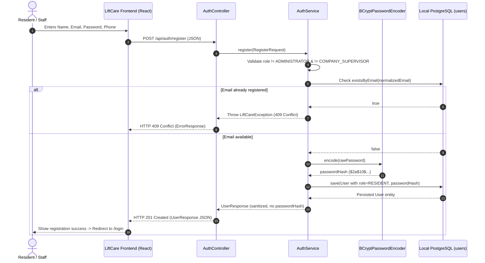
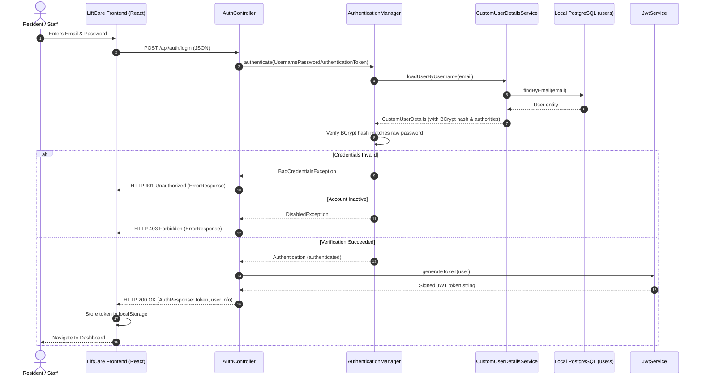
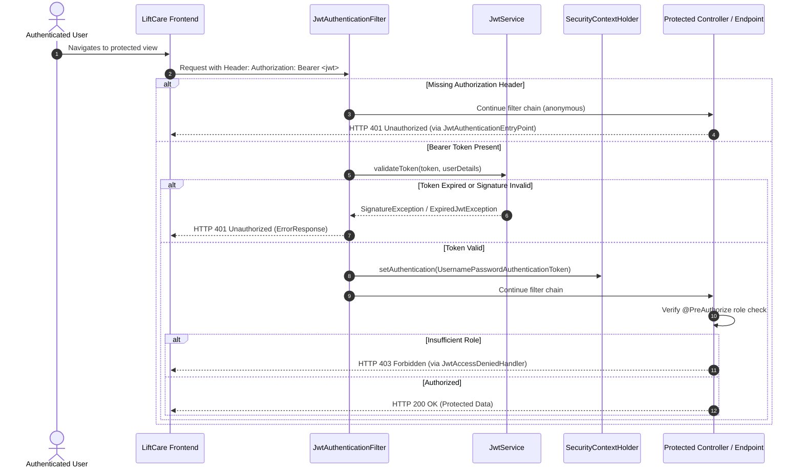

# LiftCare — Authentication and Role-Based Access Control (RBAC)
**Module 3 Technical Specification**

LiftCare is designed as an **offline-first elevator issue management and automatic escalation system**. In an emergency, such as an elevator entrapment during a severe storm or power/telecommunications outage, the building's local server must authenticate users, enforce authorization boundaries, and accept incident reports over the local network (LAN / Wi-Fi) without reaching out to external cloud identity providers (such as Auth0, Okta, Firebase, or Google OAuth).

---

## 1. Local-First Authentication Architecture

### 1.1 Guiding Principles
1. **Zero External Identity Dependencies**: All user credentials, password hashes, and authorization roles reside within the on-premise PostgreSQL database.
2. **Stateless JWT Tokens**: Once authenticated, client requests carry a cryptographically signed JSON Web Token (JWT) using HMAC-SHA256 (HS256). The local server validates the token on every request without maintaining server-side session state.
3. **Decentralized LAN Access**: Any resident, building manager, or technician on the local building Wi-Fi/Ethernet can authenticate directly against the on-premise appliance.
4. **Defense in Depth**: Password hashes are shielded using BCrypt; passwords and hashes are never exposed in logs or API responses; public registration is restricted from elevating privileges.

---

## 2. Sequence Diagrams

### 2.1 User Registration Flow



---

### 2.2 User Login & Token Issuance Flow



---

### 2.3 Protected Resource Access Flow



---

## 3. Role-Based Access Control (RBAC) Hierarchy

The LiftCare system implements six user roles with well-defined operational boundaries:

| Role | Operational Scope | Privileges |
| :--- | :--- | :--- |
| **`RESIDENT`** | Building occupant | Publicly registerable. Report elevator issues, view own reported incidents, check building elevator operational status. |
| **`SECURITY_STAFF`** | On-site building security desk | View all building incidents in real time, acknowledge emergency entrapment alerts, initiate immediate on-site response. |
| **`BUILDING_MANAGER`** | Property & facilities management | Oversee all building elevators, assign work orders, review technician response times, monitor SLA compliance. |
| **`TECHNICIAN`** | Elevator maintenance technician | Acknowledge dispatched service tickets, update incident work status (in-progress, pending parts, resolved), log work notes. |
| **`COMPANY_SUPERVISOR`** | Elevator service company regional manager | Multi-building fleet oversight, analyze SLA escalations, manage technician assignments across buildings. |
| **`ADMINISTRATOR`** | System administrator / IT operations | Configure local node parameters, provision building & elevator metadata, manage user accounts, inspect system audit logs. |

### Role Privilege Safeguards
- **Self-Registration Restrictions**: Public registration via `POST /api/auth/register` defaults to `RESIDENT`. Attempting to register as `ADMINISTRATOR` or `COMPANY_SUPERVISOR` is rejected with `HTTP 400 Bad Request`.
- **Role Authority Format**: Spring Security granted authorities are formatted with the standard `ROLE_` prefix (`ROLE_RESIDENT`, `ROLE_ADMINISTRATOR`, etc.).

---

## 4. API Endpoints

### 4.1 Public Endpoints

#### `POST /api/auth/register`
Creates a new user account.
- **Request Body**:
  ```json
  {
    "fullName": "Jane Doe",
    "email": "jane.doe@building.local",
    "password": "SecurePassword123!",
    "phoneNumber": "+1-555-0199",
    "requestedRole": "RESIDENT"
  }
  ```
- **Validation Rules**:
  - `fullName`: Required, 2-100 characters.
  - `email`: Required, valid email format, max 150 characters. Normalized to lowercase.
  - `password`: Required, minimum 8 characters, maximum 128 characters.
  - `requestedRole`: Optional. Defaults to `RESIDENT`. Values `ADMINISTRATOR` and `COMPANY_SUPERVISOR` are rejected.
- **Responses**:
  - `201 Created`:
    ```json
    {
      "id": 1,
      "fullName": "Jane Doe",
      "email": "jane.doe@building.local",
      "phoneNumber": "+1-555-0199",
      "role": "RESIDENT",
      "active": true,
      "createdAt": "2026-10-31T09:00:00Z"
    }
    ```
  - `400 Bad Request`: Validation failure or prohibited role requested.
  - `409 Conflict`: Email address already registered.

---

#### `POST /api/auth/login`
Authenticates user credentials and issues a signed JWT.
- **Request Body**:
  ```json
  {
    "email": "jane.doe@building.local",
    "password": "SecurePassword123!"
  }
  ```
- **Responses**:
  - `200 OK`:
    ```json
    {
      "token": "eyJhbGciOiJIUzI1NiJ9...",
      "tokenType": "Bearer",
      "expiresInMs": 86400000,
      "user": {
        "id": 1,
        "fullName": "Jane Doe",
        "email": "jane.doe@building.local",
        "phoneNumber": "+1-555-0199",
        "role": "RESIDENT",
        "active": true,
        "createdAt": "2026-10-31T09:00:00Z"
      }
    }
    ```
  - `401 Unauthorized`: Bad credentials.
  - `403 Forbidden`: Account is disabled (`active: false`).

---

#### `POST /api/auth/logout`
Acknowledges client session termination.
- **Request Headers**: `Authorization: Bearer <token>` (optional)
- **Response**: `200 OK`:
  ```json
  {
    "message": "Logged out successfully. Please discard your client token."
  }
  ```

---

### 4.2 Protected Endpoints

#### `GET /api/auth/me`
Retrieves the profile of the currently authenticated user.
- **Request Headers**: `Authorization: Bearer <jwt_token>`
- **Response**: `200 OK` (returns `UserResponse` DTO without password hash).
- **Error Responses**:
  - `401 Unauthorized`: Token missing, invalid, or expired.

---

#### `GET /api/auth/admin-check`
Administrative probe endpoint protected with `@PreAuthorize("hasRole('ADMINISTRATOR')")`.
- **Request Headers**: `Authorization: Bearer <jwt_token>`
- **Responses**:
  - `200 OK`: If the authenticated user has the `ADMINISTRATOR` role.
  - `403 Forbidden`: If the user is authenticated but holds another role (e.g. `RESIDENT`).
  - `401 Unauthorized`: If the request is unauthenticated.

---

## 5. Security Architecture & Implementation Details

### 5.1 Password Hashing Strategy
- Passwords are encrypted using **BCrypt** with salt generated per hash (`BCryptPasswordEncoder`).
- Plaintext passwords are never persisted to the database.
- Password hashes are excluded from all outgoing response DTOs (`UserResponse`, `AuthResponse`).
- In case of password updates, re-hashing is strictly enforced.

### 5.2 JWT Token Generation and Verification
- **Algorithm**: HMAC-SHA256 (`HS256`).
- **Secret Key**: Injected via `JWT_SECRET` environment variable. The secret must be at least 256 bits (32 bytes). An automatic validation check in `JwtProperties` warns or blocks insecure configurations in production.
- **Configurable Expiry**: Injected via `JWT_EXPIRATION_MS` (default: 86,400,000 ms = 24 hours).
- **Claims Included**:
  - `sub`: User's normalized email address.
  - `userId`: Long primary key.
  - `role`: Canonical role name (`RESIDENT`, etc.).
  - `fullName`: Display name for offline client rendering.
  - `iat`: Epoch issue timestamp.
  - `exp`: Epoch expiration timestamp.

### 5.3 Token Storage & Client-Side Considerations
- **Storage Choice**: In the React client prototype, the JWT is stored in browser `localStorage`.
- **Trade-off Analysis**:
  - *Advantage*: Enables persistent offline-first authentication across browser reloads and offline reconnections within the local intranet without requiring server-managed sticky sessions.
  - *Mitigation*: The token payload contains no confidential database secrets; the server statelessly re-validates the signature and expiration on every request.
  - *Production Path*: For high-security environments, `httpOnly`, `SameSite=Strict` secure cookies can be configured in conjunction with a CSRF token exchange.

### 5.4 Unified Error Model
All authentication failures return the standard LiftCare `ErrorResponse` model:
```json
{
  "timestamp": "2026-10-31T09:15:00Z",
  "status": 401,
  "error": "Unauthorized",
  "message": "Invalid email or password.",
  "path": "/api/auth/login"
}
```
Field-level validation failures (`POST /api/auth/register`) provide structured feedback:
```json
{
  "timestamp": "2026-10-31T09:15:00Z",
  "status": 400,
  "error": "Bad Request",
  "message": "Validation failed for one or more fields.",
  "path": "/api/auth/register",
  "validationErrors": {
    "password": "Password must be at least 8 characters long."
  }
}
```

---

## 6. Testing & Verification

Automated authentication tests are located in:
`backend/src/test/java/com/liftcare/AuthControllerTest.java`

Run the test suite with:
```powershell
cd liftcare/backend
.\mvnw.cmd test
```

The test suite covers:
1. Registration with valid resident credentials.
2. Rejection of duplicate email addresses (409 Conflict).
3. Rejection of registration with weak/short passwords (400 Bad Request).
4. Rejection of self-registration as `ADMINISTRATOR` (400 Bad Request).
5. Successful login returning signed JWT and safe user profile.
6. Login rejection on bad password (401 Unauthorized).
7. Login rejection on non-existent email (401 Unauthorized).
8. Login rejection on inactive user account (403 Forbidden).
9. Retrieval of profile via `GET /api/auth/me` with valid Bearer token.
10. Rejection of unauthenticated access to `GET /api/auth/me` (401 Unauthorized).
11. Rejection of invalid/tampered Bearer token (401 Unauthorized).
12. Role authorization verification on `GET /api/auth/admin-check`.
