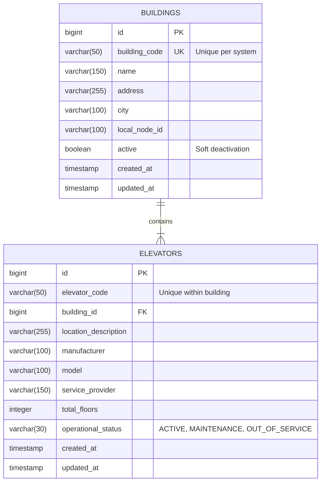
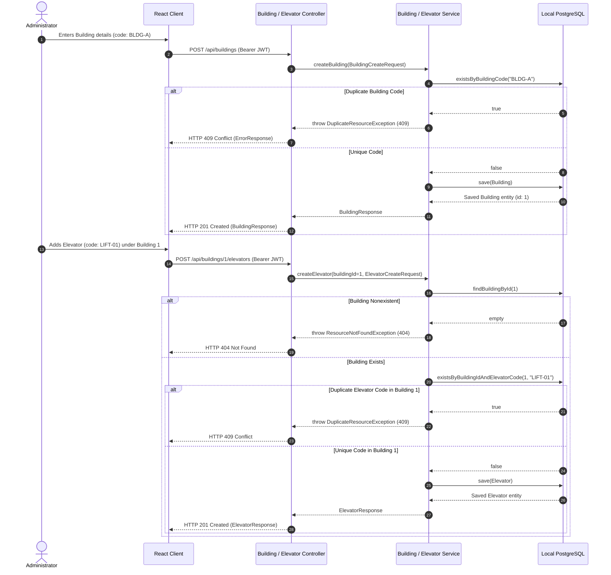
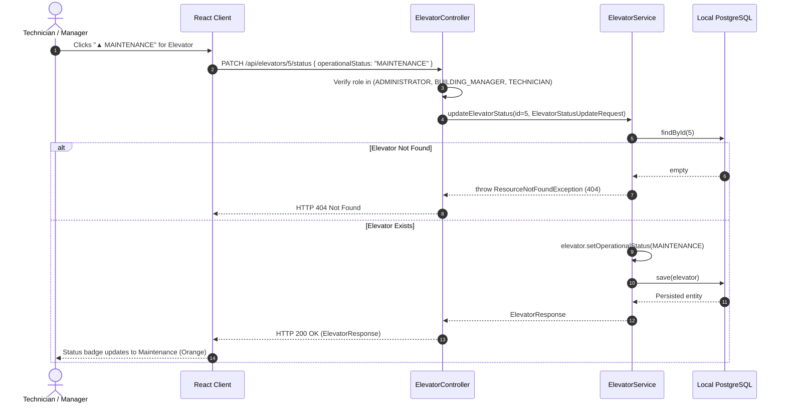

# LiftCare — Building and Elevator Management
**Module 4 Technical Specification**

LiftCare is an offline-first elevator issue management and automatic escalation system. Each building operates a dedicated on-premise local server and database over the local area network (LAN / Wi-Fi).

**Module 4** implements the physical asset infrastructure for the system:
1. **Building Complex Management**: Registering, listing, retrieving, updating, and deactivating physical buildings monitored by the local server node.
2. **Elevator Shaft Registry**: Provisioning elevator units, enforcing scoped code uniqueness within each building, tracking equipment metadata, updating real-time operational status, and deactivating units without cascade-deleting historical records.

---

## 1. Architectural Model & Scoped Uniqueness



### Uniqueness Rules:
- **`building_code`**: Must be globally unique across all buildings (`uk_buildings_code`). Attempting to register a building with an existing code returns `409 Conflict`.
- **`elevator_code`**: Must be unique **within its parent building** (`uk_elevator_building_code UNIQUE (building_id, elevator_code)`). For example, Building A and Building B can both have an elevator named `LIFT-01`, but Building A cannot have two elevators named `LIFT-01`.

---

## 2. Role-Based Permissions Policy

Permissions are strictly enforced on the server-side via Spring Security method security annotations (`@PreAuthorize`). Frontend UI controls adapt accordingly, but backend authorization remains mandatory.

| Action / Endpoint | Permitted Roles | Unauthorized Roles (HTTP 403) |
| :--- | :--- | :--- |
| **`POST /api/buildings`**<br>(Register Building) | `ADMINISTRATOR` | `BUILDING_MANAGER`, `TECHNICIAN`, `COMPANY_SUPERVISOR`, `SECURITY_STAFF`, `RESIDENT` |
| **`GET /api/buildings`**<br>(List Buildings) | All authenticated roles (`ACTIVE` only for `RESIDENT`, `SECURITY_STAFF`, `TECHNICIAN`; all for `ADMINISTRATOR`, `BUILDING_MANAGER`, `COMPANY_SUPERVISOR`) | Unauthenticated requests (HTTP 401) |
| **`GET /api/buildings/{id}`**<br>(Get Building) | All authenticated roles (Inactive buildings hidden from `RESIDENT`, `SECURITY_STAFF`) | Unauthenticated requests (HTTP 401) |
| **`PUT /api/buildings/{id}`**<br>(Update Building) | `ADMINISTRATOR`, `BUILDING_MANAGER` | `TECHNICIAN`, `COMPANY_SUPERVISOR`, `SECURITY_STAFF`, `RESIDENT` |
| **`PATCH /api/buildings/{id}/deactivate`**<br>(Deactivate Building) | `ADMINISTRATOR` | `BUILDING_MANAGER`, `TECHNICIAN`, `COMPANY_SUPERVISOR`, `SECURITY_STAFF`, `RESIDENT` |
| **`POST /api/buildings/{id}/elevators`**<br>(Create Elevator) | `ADMINISTRATOR`, `BUILDING_MANAGER` | `TECHNICIAN`, `COMPANY_SUPERVISOR`, `SECURITY_STAFF`, `RESIDENT` |
| **`GET /api/buildings/{id}/elevators`**<br>(List Elevators in Building) | All authenticated roles | Unauthenticated requests (HTTP 401) |
| **`GET /api/elevators/{id}`**<br>(Get Elevator by ID) | All authenticated roles | Unauthenticated requests (HTTP 401) |
| **`PUT /api/elevators/{id}`**<br>(Update Elevator Details) | `ADMINISTRATOR`, `BUILDING_MANAGER` | `TECHNICIAN`, `COMPANY_SUPERVISOR`, `SECURITY_STAFF`, `RESIDENT` |
| **`PATCH /api/elevators/{id}/status`**<br>(Change Operational Status) | `ADMINISTRATOR`, `BUILDING_MANAGER`, `TECHNICIAN` | `COMPANY_SUPERVISOR`, `SECURITY_STAFF`, `RESIDENT` |
| **`PATCH /api/elevators/{id}/deactivate`**<br>(Deactivate Elevator) | `ADMINISTRATOR`, `BUILDING_MANAGER` | `TECHNICIAN`, `COMPANY_SUPERVISOR`, `SECURITY_STAFF`, `RESIDENT` |

### Key Policy Decisions & Documented Limitations:
1. **Technician Status Updates**: Maintenance technicians physically inspecting or repairing an elevator need to transition units between `ACTIVE`, `MAINTENANCE`, and `OUT_OF_SERVICE`. Hence, `TECHNICIAN` is granted access to `PATCH /api/elevators/{id}/status`, but is forbidden from modifying elevator codes, deleting buildings, or changing building properties.
2. **Current Schema Limitation (User-to-Building Assignment)**:
   - *Limitation*: The current domain model does not yet contain a `building_id` foreign key or many-to-many join table on the `users` entity.
   - *Mitigation*: In this local-appliance architecture, each instance runs on an on-premise local node serving its specific building or facility complex. Therefore, `BUILDING_MANAGER` accounts present on that local node are authorized to update building metadata and manage elevators under the buildings hosted on that node. Global building creation and building deactivation remain restricted strictly to `ADMINISTRATOR`. Full multi-tenant building assignment mapping will be expanded when cloud synchronization is introduced.

---

## 3. Sequence Diagrams

### 3.1 Building Creation & Scoped Elevator Provisioning



---

### 3.2 Real-Time Elevator Operational Status Transition



---

## 4. API Endpoints Reference

### 4.1 Building Endpoints

#### `POST /api/buildings`
- **Access**: `ADMINISTRATOR` only.
- **Payload**:
  ```json
  {
    "buildingCode": "BLDG-METRO-01",
    "name": "Metropolis Grand Heights",
    "address": "500 Madison Boulevard",
    "city": "Metropolis",
    "localNodeId": "node-metropolis-01"
  }
  ```
- **Response**: `201 Created`
  ```json
  {
    "id": 1,
    "buildingCode": "BLDG-METRO-01",
    "name": "Metropolis Grand Heights",
    "address": "500 Madison Boulevard",
    "city": "Metropolis",
    "localNodeId": "node-metropolis-01",
    "active": true,
    "elevatorCount": 0,
    "createdAt": "2026-10-31T09:40:00Z",
    "updatedAt": "2026-10-31T09:40:00Z"
  }
  ```
- **Error Codes**: `400 Bad Request` (validation failed), `403 Forbidden` (non-admin), `409 Conflict` (duplicate buildingCode).

#### `GET /api/buildings`
- **Access**: Any authenticated user.
- **Query Params**: `includeInactive=true|false` (default: false; privileged users can view inactive buildings).
- **Response**: `200 OK` (Array of `BuildingResponse`).

#### `GET /api/buildings/{id}`
- **Access**: Any authenticated user.
- **Response**: `200 OK` (`BuildingResponse` with `elevatorCount`).
- **Error Codes**: `404 Not Found` (nonexistent or inactive when requested by non-privileged user).

#### `PUT /api/buildings/{id}`
- **Access**: `ADMINISTRATOR`, `BUILDING_MANAGER`.
- **Payload**:
  ```json
  {
    "name": "Metropolis Grand Heights Tower A",
    "address": "500 Madison Boulevard North",
    "city": "Metropolis",
    "localNodeId": "node-metropolis-01",
    "active": true
  }
  ```
- **Response**: `200 OK` (`BuildingResponse`).

#### `PATCH /api/buildings/{id}/deactivate` (or `DELETE /api/buildings/{id}`)
- **Access**: `ADMINISTRATOR` only.
- **Description**: Soft-deactivates the building (`active = false`). Preserves historical incident records.
- **Response**: `200 OK` (`BuildingResponse` with `active: false`).

---

### 4.2 Elevator Endpoints

#### `POST /api/buildings/{buildingId}/elevators`
- **Access**: `ADMINISTRATOR`, `BUILDING_MANAGER`.
- **Payload**:
  ```json
  {
    "elevatorCode": "LIFT-A1",
    "locationDescription": "North Tower Lobby - Passenger Car",
    "manufacturer": "Kone",
    "model": "MonoSpace 500",
    "serviceProvider": "Kone Care Field Service",
    "totalFloors": 24,
    "operationalStatus": "ACTIVE"
  }
  ```
- **Response**: `201 Created`
  ```json
  {
    "id": 10,
    "elevatorCode": "LIFT-A1",
    "buildingId": 1,
    "buildingCode": "BLDG-METRO-01",
    "buildingName": "Metropolis Grand Heights",
    "locationDescription": "North Tower Lobby - Passenger Car",
    "manufacturer": "Kone",
    "model": "MonoSpace 500",
    "serviceProvider": "Kone Care Field Service",
    "totalFloors": 24,
    "operationalStatus": "ACTIVE",
    "createdAt": "2026-10-31T09:42:00Z",
    "updatedAt": "2026-10-31T09:42:00Z"
  }
  ```
- **Error Codes**: `400 Bad Request`, `403 Forbidden`, `404 Not Found` (building not found), `409 Conflict` (duplicate elevatorCode in this building).

#### `GET /api/buildings/{buildingId}/elevators`
- **Access**: Any authenticated user.
- **Query Params**: `status=ACTIVE|MAINTENANCE|OUT_OF_SERVICE` (optional).
- **Response**: `200 OK` (Array of `ElevatorResponse`).

#### `GET /api/elevators/{id}`
- **Access**: Any authenticated user.
- **Response**: `200 OK` (`ElevatorResponse`).

#### `PUT /api/elevators/{id}`
- **Access**: `ADMINISTRATOR`, `BUILDING_MANAGER`.
- **Payload**: `ElevatorUpdateRequest` (validates code uniqueness in the elevator's building).
- **Response**: `200 OK` (`ElevatorResponse`).

#### `PATCH /api/elevators/{id}/status`
- **Access**: `ADMINISTRATOR`, `BUILDING_MANAGER`, `TECHNICIAN`.
- **Payload**:
  ```json
  {
    "operationalStatus": "MAINTENANCE"
  }
  ```
- **Response**: `200 OK` (`ElevatorResponse`).

#### `PATCH /api/elevators/{id}/deactivate` (or `DELETE /api/elevators/{id}`)
- **Access**: `ADMINISTRATOR`, `BUILDING_MANAGER`.
- **Description**: Sets `operationalStatus = OUT_OF_SERVICE`. Never executes a hard database row deletion.
- **Response**: `200 OK` (`ElevatorResponse`).

---

## 5. Next Module Integration (Module 5: Incident Reporting & Local Triage)

Module 4 creates the essential relational baseline for upcoming incident reporting:
1. **Incident Association**: Incidents reported by residents and staff will link directly to a verified `building_id` and `elevator_id`.
2. **Elevator Selection**: The incident reporting form will query `GET /api/buildings/{id}/elevators` to populate elevator dropdowns with active units.
3. **Emergency Escalation Trigger**: If an incident reports an entrapment (`entrapment_reported = true`), the system can automatically transition the affected elevator to `OUT_OF_SERVICE` or `MAINTENANCE` via `ElevatorService.updateElevatorStatus`.
