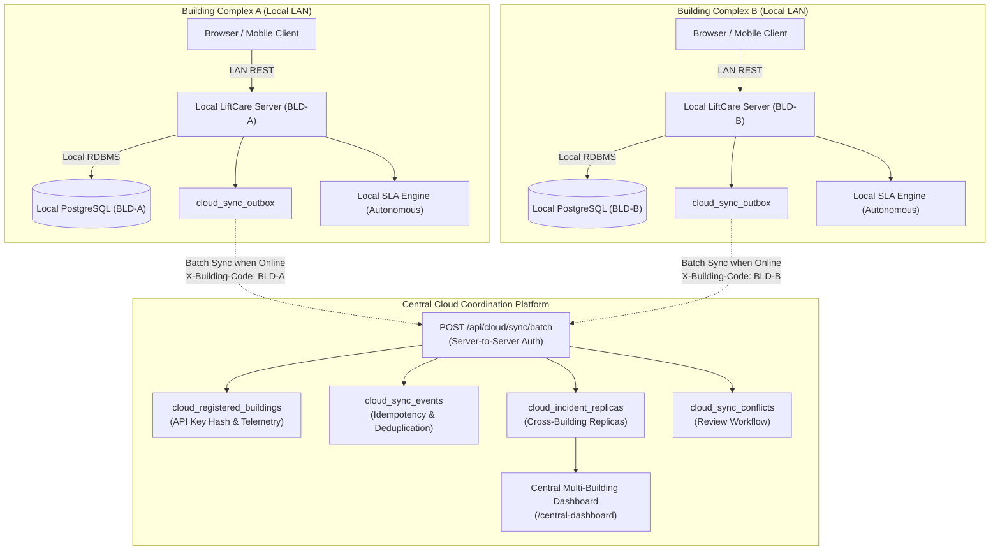
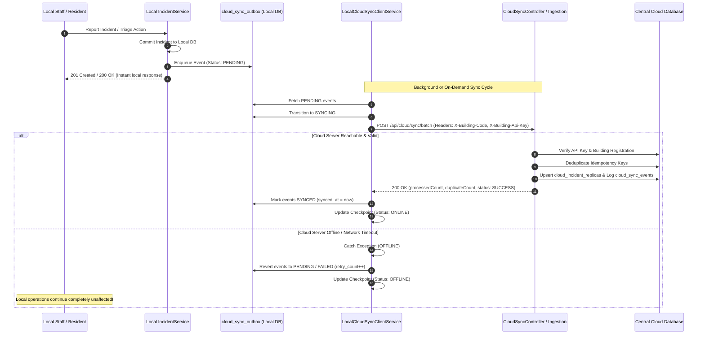

# LiftCare — Module 12: Cloud Coordination & Multi-Building Synchronization

## 1. Executive Summary & Architecture Overview

**LiftCare** is an offline-first elevator issue management and automatic escalation system designed to run on a local building server over an isolated local area network (LAN). **Module 12** extends LiftCare to support multiple buildings connected to an optional central cloud coordination server while guaranteeing that the building-local server remains 100% autonomous without internet or cloud dependencies.



### Core Architecture Axioms
1. **Local-First Autonomy**: The cloud server is strictly a coordination and aggregation node. It never controls physical elevators and is never in the critical path of local incident reporting, staff triage, audit logging, or SLA escalation.
2. **Asynchronous Decoupled Replication**: Local mutations write to a local `cloud_sync_outbox` in the same local database transaction. A separate client sync runner drains the outbox to the cloud when internet access is available.
3. **Strict Zero-Loss Recovery**: If the cloud or network is unavailable, local operations continue completely unaffected. Pending records accumulate in durable local storage and synchronize automatically upon reconnection.
4. **Tenant Isolation**: Each building authenticates via dedicated server-to-server credentials. Cross-building data submission or retrieval is strictly rejected by the server.

---

## 2. Local Server vs. Cloud Coordination Responsibilities

| Capability | Building-Local Server (Authoritative) | Central Cloud Coordination Server (Aggregated) |
| :--- | :--- | :--- |
| **User Identity & Roles** | Authoritative for local residents, building managers, and technicians. | Central administrators (`ADMINISTRATOR`) and supervisors (`COMPANY_SUPERVISOR`). |
| **Physical Assets** | Authoritative for local buildings and elevator operational states (`ACTIVE`, `MAINTENANCE`, `OUT_OF_SERVICE`). | Aggregated view of registered building complexes and elevator operational counts. |
| **Incident Reporting & Triage** | Authoritative for incident intake, passenger entrapment detection, status transitions, technician dispatch, and audit history. | Synchronized incident replicas (`cloud_incident_replicas`) for organization-wide visibility. |
| **SLA Deadlines & Escalation** | Authoritative for SLA clock tracking, warnings, and automated local staff escalations (Tiers 1, 2, and 3). | Aggregated SLA breach counts and telemetry; does not evaluate or trigger local escalations. |
| **Offline Operation** | 100% operational over building LAN without internet access. | Available only when internet/WAN connectivity is functional. |
| **Conflict Management** | Local operations always take precedence for physical safety and on-site actions. | Detects concurrent modifications and records them in `cloud_sync_conflicts` for review. |

---

## 3. Synchronization Protocol & Data Design

The synchronization protocol is backed by dedicated relational tables introduced in Flyway migration [`V8__create_cloud_coordination_and_sync_tables.sql`](file:///d:/KONE/liftcare/backend/src/main/resources/db/migration/V8__create_cloud_coordination_and_sync_tables.sql).

### 3.1 Relational Data Model

1. **`cloud_registered_buildings`** (Cloud):
   - Stores registered buildings, hashed server API keys (`api_key_hash`), status (`ACTIVE`, `SUSPENDED`), and sync health telemetry (`last_synced_at`, `last_sync_status`, `last_sync_error`).
2. **`cloud_sync_outbox`** (Local):
   - Stores queued outbound events generated by local mutations (`id`, `event_id`, `building_code`, `event_type`, `aggregate_type`, `aggregate_id`, `payload`, `status`, `retry_count`, `idempotency_key`, `created_at`, `synced_at`).
   - States: `PENDING`, `SYNCING`, `SYNCED`, `FAILED`.
3. **`cloud_sync_checkpoints`** (Local):
   - Tracks local synchronization progress (`last_successful_sync_at`, `pending_events_count`, `failed_events_count`, `cloud_connection_status`, `last_sync_error`).
4. **`cloud_sync_events`** (Cloud):
   - Deduplication event log recording every ingested event ID and idempotency key (`status = PROCESSED / DUPLICATE / CONFLICT`).
5. **`cloud_incident_replicas`** (Cloud):
   - Aggregated multi-building incident data store providing fast cross-building telemetry without querying individual local appliances.
6. **`cloud_sync_conflicts`** (Cloud):
   - Audit store of detected synchronization conflicts (`ticket_number`, `conflict_type`, `local_state`, `cloud_state`, `resolution_action`, `resolution_notes`, `resolved_by`).

### 3.2 Protocol Synchronization Flow



### 3.3 Stable Identifiers & Idempotency Keys
- **Building Identity**: Stable alphanumeric code (e.g. `BLD-A`, `BLD-B`).
- **Incident Ticket**: Globally unique deterministic ticket format: `INC-YYYYMMDD-XXXXXX`.
- **Event Identifiers**: Cryptographically random UUIDs (`event_id`).
- **Idempotency Keys**:
  - Incident Creation: `SYNC-INC-CREATE-<ticketNumber>`
  - Incident Mutation: `SYNC-INC-UPD-<ticketNumber>-<action>-<timestamp>`
  - Elevator Transition: `SYNC-ELV-<elevatorCode>-<status>-<timestamp>`

---

## 4. Conflict Resolution Rules

LiftCare implements an explicit, rule-based conflict detection model rather than blind automatic merges:

| Conflict Scenario | Resolution Rule | Authority |
| :--- | :--- | :--- |
| **Local Status Update vs. Stale Cloud Replica** | Local building updates take precedence. Incoming local status updates the cloud replica and increments `localVersion`. | **Building-Authoritative** |
| **Local Operational Status Change (Elevator)** | Local physical status changes (e.g. elevator shutdown due to entrapment) take absolute precedence. Cloud replica is updated immediately. | **Building-Authoritative** |
| **Status Regression on Closed Ticket** | If an incident is already `CLOSED` on the cloud, but an incoming event attempts to regress it to `REPORTED` or `ACKNOWLEDGED` without an explicit reopen flag, a conflict is flagged in `cloud_sync_conflicts` with `STALE_STATUS_ON_CLOSED_TICKET` and status `PENDING_REVIEW`. | **Conflict-Managed** |
| **Concurrent Operator Actions** | Discrepancies between cloud supervisor notes and local technician notes are recorded in `cloud_sync_conflicts` for manual operator review. | **Conflict-Managed** |
| **Duplicate Batch Delivery** | Duplicate events matching existing idempotency keys are acknowledged with HTTP 200 and increment `duplicateCount` without re-applying side effects. | **Idempotent No-Op** |

### Conflict Resolution Actions
Central supervisors can resolve conflicts via `PATCH /api/cloud/conflicts/{id}/resolve`:
1. `ACCEPTED_LOCAL`: Accepts building-local state as authoritative.
2. `ACCEPTED_CLOUD`: Preserves cloud replica state.
3. `RESOLVED_MANUALLY`: Manual administrative resolution with documented audit notes.

---

## 5. Multi-Building Security & Tenant Isolation

1. **Server-to-Server Authentication**:
   - Local building servers authenticate using HTTP headers `X-Building-Code` and `X-Building-Api-Key`.
   - API keys are generated with 256-bit entropy (`lc_bld_...`) and stored on the cloud server hashed with BCrypt.
   - Credentials are kept strictly on the server backend and never exposed to browser storage.
2. **Strict Tenant Isolation**:
   - `CloudSyncController` enforces that the `X-Building-Code` header exactly matches the `buildingCode` in the request body payload.
   - Attempting to submit records for another building returns HTTP 400 Bad Request (`Tenant isolation violation`).
3. **Role-Based Access Control**:
   - Central overview endpoints (`/api/cloud/dashboard/summary`, `/api/cloud/incidents`, `/api/cloud/buildings`) require `@PreAuthorize("hasAnyRole('ADMINISTRATOR', 'COMPANY_SUPERVISOR')")`.
   - Local residents and technicians cannot access cross-building central telemetry (HTTP 403 Forbidden).

---

## 6. Offline-First Verification & Cloud Outage Resilience

| Verification Scenario | Behavior & Guarantee | Verification Status |
| :--- | :--- | :---: |
| **Incident Reporting while Cloud Offline** | Local incident report succeeds with 201 Created. Elevator safety shutdown executes. Event queued in `cloud_sync_outbox`. | **VERIFIED** |
| **Local Triage while Cloud Offline** | Acknowledging, assigning, adding audit notes, and resolving incidents works 100% locally. | **VERIFIED** |
| **SLA Evaluation during Cloud Outage** | Local SLA evaluation scheduler continues evaluating deadlines and executing local escalations. | **VERIFIED** |
| **Local Sync Attempt while Cloud Offline** | Client detects offline state, logs warning, updates checkpoint to `OFFLINE`. **Zero exceptions cascade to local users**. | **VERIFIED** |
| **Durable Storage across Restarts** | Pending outbox records are stored in PostgreSQL/H2 relational tables and survive application restarts. | **VERIFIED** |
| **Resumption upon Reconnection** | Restoring connectivity drains all pending outbox records to the cloud and updates checkpoint to `ONLINE`. | **VERIFIED** |
| **Duplicate Delivery Prevention** | Replayed batches return 200 OK with `duplicateCount > 0` and create zero duplicate cloud incident rows. | **VERIFIED** |

---

## 7. Frontend User Interfaces

### 7.1 Local Synchronization Status View (`/cloud-sync`)
Accessible by building managers and administrators from the navigation bar:
- **Offline Autonomy Banner**: Confirms local server and database are 100% operational over LAN.
- **Connection Indicator**: Real-time status badge (`ONLINE`, `OFFLINE`, `SYNCING`, `ERROR`).
- **Queue Telemetry**: Displays pending outbox events and failed retries.
- **Sync Outbox Button**: Safe manual trigger for staff to synchronize pending records on demand.
- **Diagnostic Simulation**: Controls to simulate cloud disconnect and recovery for demonstrations.

### 7.2 Central Multi-Building Dashboard (`/central-dashboard`)
Accessible by company supervisors and central administrators:
- **Aggregated Fleet Telemetry**: Total registered buildings, active buildings, open incidents, critical emergencies, entrapments, and SLA breaches.
- **Delayed Sync Warning**: Prominent banner displayed if any building has not synced in > 15 minutes.
- **Registered Buildings Status Table**: Lists building codes, last sync time, sync status, and active incident counts.
- **Cross-Building Incident Replicas**: Searchable and filterable table (by building, severity, status).
- **Conflict Management Modal**: Inspects and resolves detected sync conflicts with full audit attribution.

---

## 8. Automated Integration Test Suite (`Module12CloudSynchronizationTest`)

The test suite is implemented in [`Module12CloudSynchronizationTest.java`](file:///d:/KONE/liftcare/backend/src/test/java/com/liftcare/Module12CloudSynchronizationTest.java):

```
[INFO] Running com.liftcare.Module12CloudSynchronizationTest
[INFO] Tests run: 7, Failures: 0, Errors: 0, Skipped: 0, Time elapsed: 18.28 s -- in com.liftcare.Module12CloudSynchronizationTest
[INFO] Results:
[INFO] Tests run: 7, Failures: 0, Errors: 0, Skipped: 0
[INFO] BUILD SUCCESS
```

### Scenario Breakdown:
1. `testBuildingRegistrationAndCredentialValidation`: Verifies registration, API key generation, credential validation, and rejection of duplicate building codes.
2. `testMultiBuildingTenantIsolation`: Verifies that submitting records for Building B while authenticated as Building A is rejected with 400 Bad Request, and invalid credentials return 401 Unauthorized.
3. `testLocalOutboxCaptureOnLocalMutations`: Verifies that reporting an incident locally automatically captures an outbox record in `cloud_sync_outbox`.
4. `testBatchIngestionAndIdempotentDeduplication`: Tests batch processing, creation of central `CloudIncidentReplica`, and idempotent duplicate handling on replay.
5. `testConflictDetectionAndResolution`: Tests conflict detection when an update attempts to regress a closed ticket, and verifies resolution via central supervisor API.
6. `testCloudOutageLocalOperationContinuityAndRecovery`: Simulates cloud disconnect, creates critical entrapment locally, asserts elevator shutdown, confirms local operations continue, restores cloud link, and verifies automatic outbox draining.
7. `testCentralDashboardAggregationAndPermissions`: Verifies multi-building telemetry aggregation for supervisors, building-level filtering, and 403 Forbidden rejection for residents.

---

## 9. Full System Test Results & Production Build

### Backend Test Suite (109 Tests Passed)
```
[INFO] Results:
[INFO] Tests run: 109, Failures: 0, Errors: 0, Skipped: 0
[INFO] ------------------------------------------------------------------------
[INFO] BUILD SUCCESS
[INFO] Total time:  01:31 min
[INFO] ------------------------------------------------------------------------
```

### Frontend Production Build
```
> liftcare-frontend@1.0.0 build
> vite build

vite v6.4.5 building for production...
transforming...
✓ 55 modules transformed.
rendering chunks...
computing gzip size...
dist/index.html                   0.77 kB │ gzip:  0.49 kB
dist/assets/index-9hICNR9K.css    9.46 kB │ gzip:  2.55 kB
dist/assets/index-DY_v6v5s.js   399.21 kB │ gzip: 97.56 kB
✓ built in 2.41s
```

---

## 10. Deployment and Configuration Guide

### 10.1 Environment Variables

| Variable | Scope | Description | Default |
| :--- | :--- | :--- | :--- |
| `LIFTCARE_BUILDING_CODE` | Local | Identifier of the local building complex | `BLD-A` |
| `LIFTCARE_CLOUD_URL` | Local | URL of central cloud coordination server | `http://central-cloud:8080` |
| `LIFTCARE_BUILDING_API_KEY` | Local | Secret server API key assigned by cloud | `""` |
| `DB_URL` | Both | PostgreSQL JDBC connection URL | `jdbc:postgresql://postgres:5432/liftcare` |
| `DB_USERNAME` | Both | Database user | `postgres` |
| `DB_PASSWORD` | Both | Database password | `postgres` |
| `JWT_SECRET` | Both | 256-bit secret key for user tokens | `(configured secret)` |

### 10.2 Operational Commands

```bash
# Register a new building with the cloud platform
curl -X POST http://localhost:8080/api/cloud/buildings/register \
  -H "Authorization: Bearer <ADMIN_JWT>" \
  -H "Content-Type: application/json" \
  -d '{"buildingCode": "BLD-TOWER-1", "buildingName": "Tower One Complex"}'

# Trigger local sync manually
curl -X POST http://localhost:8080/api/local-sync/trigger?buildingCode=BLD-A \
  -H "Authorization: Bearer <MANAGER_JWT>"

# Query central multi-building dashboard summary
curl -X GET http://localhost:8080/api/cloud/dashboard/summary \
  -H "Authorization: Bearer <SUPERVISOR_JWT>"
```

---

## 11. Explicit Scope Boundaries & Non-Goals

* **No Elevator Hardware Control**: LiftCare is a software incident logging and workflow platform. It does not interface with physical elevator drive controllers, PLCs, safety circuits, or hardware relays.
* **No Sensor Integrations**: Incident severity, status, and elevator operational states represent software records and manual operator workflows; no physical IoT sensors or accelerometers are connected.
* **No Life-Safety Certification**: The system does not replace physical elevator interlocks, fire alarm systems, or certified emergency dispatch services. Emergency entrapments require physical on-site verification.
* **Cloud Outage Resilience**: Local incident operations, history, and SLA evaluation never depend on cloud API availability.
