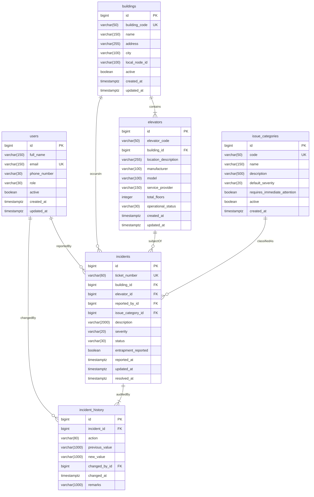

# LiftCare — Database Design & Entity Architecture

## 1. Overview

LiftCare's persistence tier is designed for an on-premise relational **PostgreSQL** database situated inside each building's local area network. It maintains ACID guarantees, durable incident history, building-scoped elevator topologies, and localized SLA tracking even during complete internet disconnects.

---

## 2. Entity-Relationship Diagram (ERD)



---

## 3. Entities & Schema Specifications

### 3.1. `User` (`users` table)
Represents actors interacting with the system. Authentication credentials (passwords, JWT) will be added in Module 3.

- **`id`** (`BIGSERIAL PRIMARY KEY`): Unique identifier.
- **`full_name`** (`VARCHAR(150) NOT NULL`): Legal or display name.
- **`email`** (`VARCHAR(150) UNIQUE NOT NULL`): Email address for identification.
- **`phone_number`** (`VARCHAR(30)`): Optional SMS/telephony contact.
- **`role`** (`VARCHAR(30) NOT NULL`): Enumerated security persona.
  - Supported roles: `RESIDENT`, `SECURITY_STAFF`, `BUILDING_MANAGER`, `TECHNICIAN`, `COMPANY_SUPERVISOR`, `ADMINISTRATOR`.
- **`active`** (`BOOLEAN NOT NULL DEFAULT TRUE`): Operational status.
- **`created_at`** / **`updated_at`** (`TIMESTAMP WITH TIME ZONE NOT NULL`): Audit timestamps.

### 3.2. `Building` (`buildings` table)
Represents a physical property complex managed by a localized LiftCare appliance.

- **`id`** (`BIGSERIAL PRIMARY KEY`): Unique identifier.
- **`building_code`** (`VARCHAR(50) UNIQUE NOT NULL`): Human-readable code (e.g., `BLD-APEX`).
- **`name`** (`VARCHAR(150) NOT NULL`): Building or complex name.
- **`address`** (`VARCHAR(255) NOT NULL`): Street address.
- **`city`** (`VARCHAR(100)`): Municipal location.
- **`local_node_id`** (`VARCHAR(100)`): Unique appliance hardware identifier (e.g., `building-local-node-01`).
- **`active`** (`BOOLEAN NOT NULL DEFAULT TRUE`): Operational flag.
- **`created_at`** / **`updated_at`** (`TIMESTAMP WITH TIME ZONE NOT NULL`): Audit timestamps.

### 3.3. `Elevator` (`elevators` table)
Represents a vertical conveyance unit operating within a building.

- **`id`** (`BIGSERIAL PRIMARY KEY`): Unique identifier.
- **`elevator_code`** (`VARCHAR(50) NOT NULL`): Unit identifier (e.g., `LIFT-01`, `CAR-B`).
  - **Scoped Uniqueness**: `UNIQUE (building_id, elevator_code)`. Elevator codes are unique within their building, but identical codes can exist across different buildings.
- **`building_id`** (`BIGINT NOT NULL REFERENCES buildings(id) ON DELETE RESTRICT`): Foreign key to containing building.
- **`location_description`** (`VARCHAR(255)`): E.g., "North Lobby, East Shaft, High-Rise Bank".
- **`manufacturer`** (`VARCHAR(100)`): E.g., "KONE", "Otis", "Schindler".
- **`model`** (`VARCHAR(100)`): Hardware model designation.
- **`service_provider`** (`VARCHAR(150)`): Maintenance maintenance vendor.
- **`total_floors`** (`INTEGER CHECK (total_floors > 0)`): Traversed floor count.
- **`operational_status`** (`VARCHAR(30) NOT NULL`):
  - Supported statuses: `ACTIVE`, `MAINTENANCE`, `OUT_OF_SERVICE`.
- **`created_at`** / **`updated_at`** (`TIMESTAMP WITH TIME ZONE NOT NULL`): Audit timestamps.

### 3.4. `IssueCategory` (`issue_categories` table)
Classification taxonomy for reported elevator faults and safety defects.

- **`id`** (`BIGSERIAL PRIMARY KEY`): Unique identifier.
- **`code`** (`VARCHAR(50) UNIQUE NOT NULL`): Machine-readable category key.
- **`name`** (`VARCHAR(150) NOT NULL`): Friendly label.
- **`description`** (`VARCHAR(500)`): Explanatory guidance.
- **`default_severity`** (`VARCHAR(20) NOT NULL`): Initial severity level (`LOW`, `MEDIUM`, `HIGH`, `CRITICAL`).
- **`requires_immediate_attention`** (`BOOLEAN NOT NULL DEFAULT FALSE`): Emergency flag (e.g., passenger entrapment).
- **`active`** (`BOOLEAN NOT NULL DEFAULT TRUE`): Availability flag.
- **`created_at`** (`TIMESTAMP WITH TIME ZONE NOT NULL`): Audit timestamp.

#### Seeded Default Categories:
1. `PASSENGER_ENTRAPMENT` — Passenger entrapment (`CRITICAL`, `requires_immediate_attention = TRUE`)
2. `ELEVATOR_NOT_OPERATING` — Elevator not operating (`HIGH`)
3. `DOOR_MALFUNCTION` — Door malfunction (`HIGH`)
4. `ELECTRICAL_CONTROL_PANEL` — Electrical or control panel issue (`HIGH`)
5. `UNUSUAL_NOISE_VIBRATION` — Unusual noise or vibration (`MEDIUM`)
6. `FLOOR_ALIGNMENT_PROBLEM` — Floor alignment problem (`MEDIUM`)
7. `ROUTINE_MAINTENANCE` — Routine maintenance request (`LOW`)
8. `OTHER_ISSUE` — Other issue (`LOW`)

### 3.5. `Incident` (`incidents` table)
Primary operational record for reported failures and service requests.

- **`id`** (`BIGSERIAL PRIMARY KEY`): Unique identifier.
- **`ticket_number`** (`VARCHAR(60) UNIQUE NOT NULL`): Human-readable ticket ID (e.g., `INC-20261030-001`).
- **`building_id`** (`BIGINT NOT NULL REFERENCES buildings(id) ON DELETE RESTRICT`): Building context.
- **`elevator_id`** (`BIGINT NOT NULL REFERENCES elevators(id) ON DELETE RESTRICT`): Elevator unit.
- **`reported_by_id`** (`BIGINT REFERENCES users(id) ON DELETE RESTRICT`): Optional user reference.
- **`issue_category_id`** (`BIGINT NOT NULL REFERENCES issue_categories(id) ON DELETE RESTRICT`): Problem taxonomy.
- **`description`** (`VARCHAR(2000) NOT NULL`): Detailed issue narrative.
- **`severity`** (`VARCHAR(20) NOT NULL`): `LOW`, `MEDIUM`, `HIGH`, `CRITICAL`.
- **`status`** (`VARCHAR(30) NOT NULL`):
  - Supported statuses: `REPORTED`, `ACKNOWLEDGED`, `ASSIGNED`, `IN_PROGRESS`, `RESOLVED`, `CLOSED`.
- **`entrapment_reported`** (`BOOLEAN NOT NULL DEFAULT FALSE`): Red-flag indicator for physical entrapment.
- **`reported_at`** (`TIMESTAMP WITH TIME ZONE NOT NULL`): Submission timestamp.
- **`updated_at`** (`TIMESTAMP WITH TIME ZONE NOT NULL`): Last activity timestamp.
- **`resolved_at`** (`TIMESTAMP WITH TIME ZONE`): Resolution completion timestamp.

### 3.6. `IncidentHistory` (`incident_history` table)
Immutable chronological audit log capturing lifecycle transitions.

- **`id`** (`BIGSERIAL PRIMARY KEY`): Unique identifier.
- **`incident_id`** (`BIGINT NOT NULL REFERENCES incidents(id) ON DELETE RESTRICT`): Associated incident.
- **`action`** (`VARCHAR(80) NOT NULL`): Action descriptor (e.g., `INCIDENT_REPORTED`, `STATUS_CHANGED`, `TECHNICIAN_ASSIGNED`).
- **`previous_value`** (`VARCHAR(1000)`): State before modification.
- **`new_value`** (`VARCHAR(1000)`): State after modification.
- **`changed_by_id`** (`BIGINT REFERENCES users(id) ON DELETE RESTRICT`): Modifying actor.
- **`changed_at`** (`TIMESTAMP WITH TIME ZONE NOT NULL`): Recorded event timestamp.
- **`remarks`** (`VARCHAR(1000)`): Operator or technician notes.

---

## 4. Integrity, Relationships, and Anti-Cascade Rules

1. **Anti-Cascade Policy**: All foreign keys to primary operational entities (`buildings`, `elevators`, `users`, `incidents`) enforce `ON DELETE RESTRICT`. Deleting an elevator or incident will **never** silently cascade and delete historical incident audit logs.
2. **Infinite Recursion Prevention**: All `@ManyToOne` associations use `FetchType.LAZY` and entity `toString()`, `equals()`, and `hashCode()` methods avoid circular traversals.
3. **No String Ordinals**: All enums are persisted strictly as `EnumType.STRING` for database portability and transparent querying via `psql` or external reporting tools.
4. **Optimized Indexes**:
   - `idx_users_email` (Unique)
   - `idx_buildings_code` (Unique)
   - `idx_elevators_building`
   - `idx_incidents_ticket` (Unique)
   - `idx_incidents_bld_status` (`(building_id, status)`)
   - `idx_incidents_elevator`
   - `idx_incidents_reported_at`
   - `idx_history_incident_date` (`(incident_id, changed_at)`)

---

## 5. Database Migrations (Flyway)

Versioned SQL migrations are organized under:
`backend/src/main/resources/db/migration/`

- **`V1__create_core_tables.sql`**: Creates tables, primary keys, foreign keys, unique constraints, check constraints, and composite indexes.
- **`V2__insert_default_issue_categories.sql`**: Seeds default categories idempotently using `ON CONFLICT (code) DO NOTHING`.

### Applying Migrations Against PostgreSQL:
When PostgreSQL is active, configure your `.env` or set environment variables:
```bash
FLYWAY_ENABLED=true
DB_URL=jdbc:postgresql://localhost:5432/liftcare_db
DB_USERNAME=postgres
DB_PASSWORD=your_password
```
Running `.\mvnw.cmd spring-boot:run` will automatically execute Flyway migrations on startup.
