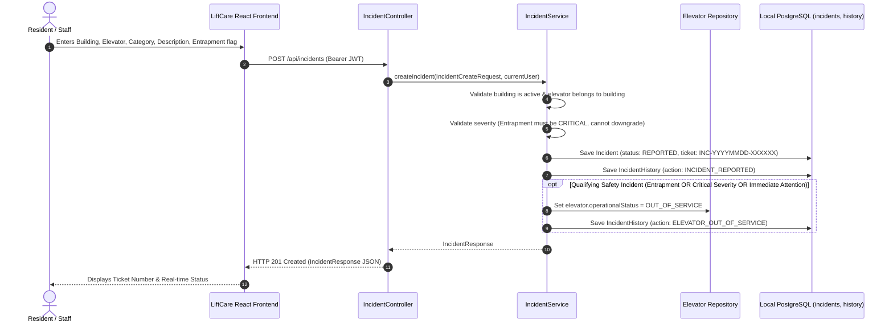
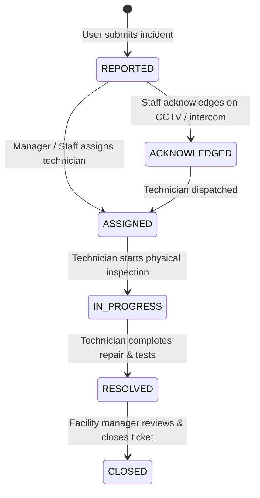

# LiftCare — Incident Reporting and Local Triage
**Module 5 Technical Specification**

LiftCare is an offline-first elevator issue management and automatic escalation system. In emergency and outage situations, the building's local server processes incident submissions, priority assessments, safety-driven elevator operational status adjustments, and on-site staff triage over the local network (LAN / Wi-Fi) without requiring external internet access.

---

## 1. Architecture & Triage Workflow



---

## 2. Severity and Emergency Entrapment Rules

LiftCare implements four standardized severity levels: `LOW`, `MEDIUM`, `HIGH`, `CRITICAL`.

### 2.1 Passenger Entrapment Safety Policy
Passenger entrapment is the highest-priority elevator emergency. The triage engine enforces the following mandatory rules:
1. **Mandatory Critical Ranking**: Any incident where `entrapmentReported == true` or where the category is `PASSENGER_ENTRAPMENT` is automatically ranked as **`CRITICAL`**.
2. **Strict Downgrade Prevention**: If a client submits `entrapmentReported: true` with a requested severity of `LOW` or `MEDIUM`, the backend rejects the request with **`HTTP 400 Bad Request`** (`"Passenger entrapment incidents require CRITICAL severity and cannot be submitted with LOW or MEDIUM severity."`).
3. **Category-Level Safeguards**: If an issue category has `requiresImmediateAttention == true` (such as power failure during run or safety gear trip), submitting with `LOW` severity is rejected with `HTTP 400 Bad Request`.
4. **Default Severity Inheritance**: When severity is omitted by the reporter, the system automatically defaults to the selected `IssueCategory.defaultSeverity`.

> **Important Emergency Disclaimer**: Software-recorded incident tickets coordinate on-site staff and technician triage. They **do not replace emergency first-responders (911/fire/rescue)**, qualified elevator engineers, or local municipal building safety protocols.

---

## 3. Elevator Operational Status Safety Transitions

When a qualifying safety incident occurs, the local system automatically transitions the affected elevator shaft to **`OUT_OF_SERVICE`** in the same transactional boundary (`@Transactional`).

### 3.1 Qualifying Incident Conditions:
An elevator is automatically marked `OUT_OF_SERVICE` if:
1. `entrapmentReported == true` (passengers trapped in cabin), **OR**
2. `severity == CRITICAL`, **OR**
3. `issueCategory.requiresImmediateAttention == true` AND `severity == HIGH`.

### 3.2 Non-Qualifying Incidents:
Non-qualifying reports (e.g. `LOW` severity light flickering, minor cosmetic scratches, `MEDIUM` squeaks without entrapment) **do not** trigger elevator status changes. The elevator remains `ACTIVE`.

### 3.3 Audit Trail Recording:
When an automatic status transition occurs:
- The elevator entity is updated in the database.
- An immutable `IncidentHistory` record is written:
  - `action`: `ELEVATOR_OUT_OF_SERVICE`
  - `previousValue`: Previous operational status (e.g. `ACTIVE`)
  - `newValue`: `OUT_OF_SERVICE`
  - `remarks`: `"Elevator automatically transitioned to OUT_OF_SERVICE due to safety incident (INC-...)"`

> **Note on Physical Hardware**: The system represents **software-recorded operational status** inside the database and on staff dashboards. This platform does not directly interface with elevator CAN bus, relay controllers, or physical hardware interlocks.

---

## 4. Lifecycle States & Supported Transitions



### 4.1 Permitted Transitions & Role Authorization Matrix

| Action / Transition | Endpoint | Authorized Roles | Notes |
| :--- | :--- | :--- | :--- |
| **Submit Incident** | `POST /api/incidents` | All authenticated roles (`RESIDENT`, `SECURITY_STAFF`, `BUILDING_MANAGER`, `TECHNICIAN`, `COMPANY_SUPERVISOR`, `ADMINISTRATOR`) | Reporter identity is derived strictly from the authenticated JWT. Client cannot forge reporter ID. Initial status: `REPORTED`. |
| **Acknowledge** | `PATCH /api/incidents/{id}/acknowledge` | `SECURITY_STAFF`, `BUILDING_MANAGER`, `TECHNICIAN`, `COMPANY_SUPERVISOR`, `ADMINISTRATOR` | Transitions `REPORTED` -> `ACKNOWLEDGED`. Residents cannot acknowledge tickets. |
| **Assign Technician** | `PATCH /api/incidents/{id}/assign` | `BUILDING_MANAGER`, `SECURITY_STAFF`, `COMPANY_SUPERVISOR`, `ADMINISTRATOR` | Target user must exist, be active, and hold the `TECHNICIAN` role. Transitions status to `ASSIGNED`. |
| **Start Diagnostic** | `PATCH /api/incidents/{id}/status` (`status: IN_PROGRESS`) | `TECHNICIAN`, `BUILDING_MANAGER`, `ADMINISTRATOR` | Transitions to `IN_PROGRESS`. Records work commencement in history. |
| **Resolve Incident** | `PATCH /api/incidents/{id}/status` (`status: RESOLVED`) | `TECHNICIAN`, `BUILDING_MANAGER`, `ADMINISTRATOR` | Transitions to `RESOLVED` and sets `resolvedAt` timestamp. Records resolution notes in history. |
| **Close Incident** | `PATCH /api/incidents/{id}/status` (`status: CLOSED`) | `BUILDING_MANAGER`, `ADMINISTRATOR` | Concludes incident lifecycle. Closed tickets cannot be edited. |

---

## 5. Scope-Based Access Control

- **`RESIDENT` Scope**:
  - Residents can only view incidents that they personally reported (`GET /api/incidents`, `GET /api/incidents/my`, `GET /api/incidents/{id}`).
  - Attempting to inspect another resident's incident ticket via `GET /api/incidents/{id}` returns **`HTTP 403 Forbidden`**.
  - Residents cannot perform triage operations (acknowledge, assign, status changes).
- **Staff Scopes (`SECURITY_STAFF`, `BUILDING_MANAGER`, `TECHNICIAN`, `COMPANY_SUPERVISOR`, `ADMINISTRATOR`)**:
  - Full visibility into all incidents reported on this local appliance node.
  - Can query by building (`GET /api/buildings/{id}/incidents`), by elevator (`GET /api/elevators/{id}/incidents`), or with filters (`?status=`, `?severity=`, `?entrapmentOnly=true`).

---

## 6. Immutable Audit Trail (`incident_history`)

Every state transition, assignment, status change, and automated safety action writes an entry to `incident_history`:
- **`incident_id`**: Foreign key to the incident.
- **`action`**: `INCIDENT_REPORTED`, `ACKNOWLEDGED`, `ASSIGNED`, `STATUS_CHANGED`, `RESOLVED`, `CLOSED`, `ELEVATOR_OUT_OF_SERVICE`.
- **`previous_value`**: Old status or previous technician.
- **`new_value`**: Updated status or newly assigned technician.
- **`changed_by_id`**: Authenticated actor who performed the transition.
- **`changed_at`**: Instant timestamp generated server-side.
- **`remarks`**: Explanatory work notes or resolution findings.

> **Audit Integrity**: There are **no endpoints** to modify or delete audit history entries. Audit records are strictly append-only.

---

## 7. API Reference & Payloads

### 7.1 Create Incident
`POST /api/incidents`
```json
{
  "buildingId": 1,
  "elevatorId": 4,
  "issueCategoryId": 1,
  "description": "Elevator car stalled between floors 5 and 6 with 2 passengers inside. Emergency alarm sounding.",
  "severity": "CRITICAL",
  "entrapmentReported": true
}
```
**Response: `201 Created`**
```json
{
  "id": 12,
  "ticketNumber": "INC-20261031-8A4F10",
  "buildingId": 1,
  "buildingCode": "BLD-ALPHA",
  "buildingName": "Alpha Sky Tower",
  "elevatorId": 4,
  "elevatorCode": "LIFT-02",
  "reportedById": 5,
  "reportedByName": "Jane Doe",
  "reportedByEmail": "jane.doe@example.com",
  "assignedToId": null,
  "assignedToName": null,
  "assignedToEmail": null,
  "issueCategoryId": 1,
  "issueCategoryCode": "PASSENGER_ENTRAPMENT",
  "issueCategoryName": "Passenger entrapment",
  "description": "Elevator car stalled between floors 5 and 6 with 2 passengers inside. Emergency alarm sounding.",
  "severity": "CRITICAL",
  "status": "REPORTED",
  "entrapmentReported": true,
  "reportedAt": "2026-10-31T09:50:00Z",
  "updatedAt": "2026-10-31T09:50:00Z",
  "resolvedAt": null
}
```

### 7.2 Get Incident Details & History
`GET /api/incidents/{id}`
**Response: `200 OK`**
```json
{
  "incident": {
    "id": 12,
    "ticketNumber": "INC-20261031-8A4F10",
    "buildingId": 1,
    "buildingCode": "BLD-ALPHA",
    "buildingName": "Alpha Sky Tower",
    "elevatorId": 4,
    "elevatorCode": "LIFT-02",
    "reportedById": 5,
    "reportedByName": "Jane Doe",
    "reportedByEmail": "jane.doe@example.com",
    "assignedToId": 8,
    "assignedToName": "Alex Rivera",
    "assignedToEmail": "alex.tech@example.com",
    "issueCategoryId": 1,
    "issueCategoryCode": "PASSENGER_ENTRAPMENT",
    "issueCategoryName": "Passenger entrapment",
    "description": "Elevator car stalled between floors 5 and 6 with 2 passengers inside. Emergency alarm sounding.",
    "severity": "CRITICAL",
    "status": "ASSIGNED",
    "entrapmentReported": true,
    "reportedAt": "2026-10-31T09:50:00Z",
    "updatedAt": "2026-10-31T09:52:00Z",
    "resolvedAt": null
  },
  "history": [
    {
      "id": 20,
      "incidentId": 12,
      "action": "INCIDENT_REPORTED",
      "previousValue": null,
      "newValue": "REPORTED",
      "changedById": 5,
      "changedByName": "Jane Doe",
      "changedByEmail": "jane.doe@example.com",
      "changedByRole": "RESIDENT",
      "changedAt": "2026-10-31T09:50:00Z",
      "remarks": "Incident report submitted via local building network. Initial severity: CRITICAL"
    },
    {
      "id": 21,
      "incidentId": 12,
      "action": "ELEVATOR_OUT_OF_SERVICE",
      "previousValue": "ACTIVE",
      "newValue": "OUT_OF_SERVICE",
      "changedById": 5,
      "changedByName": "Jane Doe",
      "changedByEmail": "jane.doe@example.com",
      "changedByRole": "RESIDENT",
      "changedAt": "2026-10-31T09:50:00Z",
      "remarks": "Elevator automatically transitioned to OUT_OF_SERVICE due to safety incident (INC-20261031-8A4F10)"
    },
    {
      "id": 22,
      "incidentId": 12,
      "action": "ASSIGNED",
      "previousValue": "UNASSIGNED",
      "newValue": "Alex Rivera (alex.tech@example.com)",
      "changedById": 2,
      "changedByName": "Mary Manager",
      "changedByEmail": "manager@liftcare.local",
      "changedByRole": "BUILDING_MANAGER",
      "changedAt": "2026-10-31T09:52:00Z",
      "remarks": "Priority dispatch: on-site technician en route to machine room"
    }
  ]
}
```

### 7.3 Assign Technician
`PATCH /api/incidents/{id}/assign`
```json
{
  "technicianId": 8,
  "remarks": "Priority dispatch to machine room"
}
```

### 7.4 Update Status / Resolve
`PATCH /api/incidents/{id}/status`
```json
{
  "status": "RESOLVED",
  "remarks": "Reset safety relay, leveled car to 5th floor, passengers safely assisted out. Tested 10 cycles without fault."
}
```

---

## 8. Limitations & Scope Boundaries

1. **User-to-Building Assignment**:
   The database schema does not currently link user accounts to a specific building via foreign key. In this single-node appliance deployment, users interact with the facilities managed by the local building server. Multi-building scoping for managers will be added during multi-building cloud synchronization.
2. **SLA Policies & Automatic Escalation Timers**:
   Formal response deadlines, tier-1/2/3 automatic escalations, and SLA breach monitors are **deferred to Module 6**.
3. **Hardware / Sensor Integration**:
   The system does not connect to real physical elevator hardware or emergency intercom hardware. It operates purely as an operational software coordination system.
4. **PostgreSQL Verification Status**:
   PostgreSQL is not installed or running on this local development machine (`localhost:5432` unreachable). All database mapping, relationships, constraints, and transactions were validated using H2 in PostgreSQL compatibility mode (`scope: test`).
