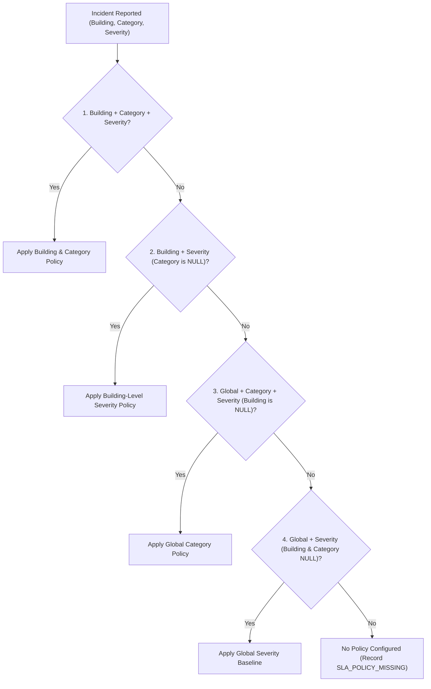
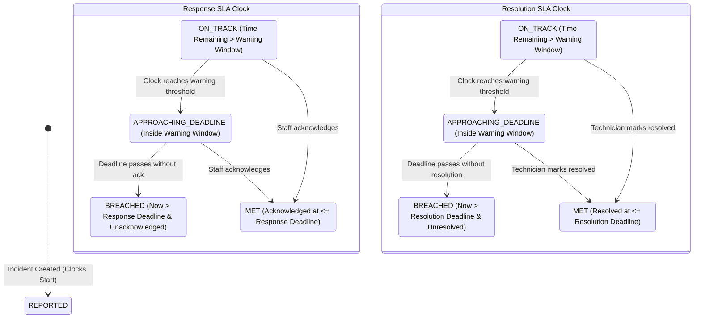

# LiftCare — Module 10: SLA Monitoring & Automatic Escalation Engine

## 1. Executive Summary & Core Principles

In an offline-first elevator incident management system, operational dispatch responsiveness and accountability are critical. While elevators operate within buildings that may experience intermittent or completely absent external internet access, the building's local server continues to coordinate response workflows.

**Module 10: SLA Monitoring and Automatic Escalation Engine** introduces a deterministic, policy-driven SLA calculation and automated multi-tier escalation framework executed entirely on the building's local server.

### Key Architectural Tenets:
1. **Local Server Autonomy**: SLA monitoring, evaluation, and escalation triggers run 100% locally on the building server. No external cloud connectivity, remote microservices, or public internet APIs are required.
2. **Dual Independent Clocks**: Response SLA (target to acknowledge/verify the report) and Resolution SLA (target to resolve the mechanical/electrical malfunction) are tracked as independent state machines. Acknowledging a ticket satisfies Response SLA without completing Resolution SLA; reopening an incident resets resolution compliance while preserving historical records.
3. **Historical Target Immutability**: When an incident is reported, the applicable SLA targets and calculated deadlines are snapshotted directly onto the incident record (`sla_response_target_minutes`, `sla_resolution_target_minutes`, `response_deadline`, `resolution_deadline`). Subsequent administrative policy modifications or deactivations never mutate the historical commitments of existing incidents.
4. **Deterministic Precedence Hierarchy**: Clear four-tier policy precedence resolves building-specific and category-specific overrides down to global baselines, with explicit missing policy detection (`SLA_POLICY_MISSING`).
5. **Durable Escalation & Audit**: Automated warnings, breaches, and tier escalations generate tamper-evident audit records in `incident_history` with `actor_type: SYSTEM`, while queuing durable dispatch records in the `notification_outbox` table with deterministic deduplication keys.
6. **Physical Safety Boundaries**: The system explicitly decouples software notification dispatch timing from physical on-site life-safety rescue operations. The software makes no claim that emergency services were phoned or that physical cabin safety was verified.

---

## 2. Relational Database Schema & Migrations

Database schema changes were established via Flyway migration [`V7__create_sla_policies_and_incident_sla_tracking.sql`](file:///d:/KONE/liftcare/backend/src/main/resources/db/migration/V7__create_sla_policies_and_incident_sla_tracking.sql).

### 2.1 The `sla_policies` Table

```sql
CREATE TABLE sla_policies (
    id BIGSERIAL PRIMARY KEY,
    name VARCHAR(150) NOT NULL,
    description TEXT,
    building_id BIGINT REFERENCES buildings(id) ON DELETE CASCADE,
    issue_category_id BIGINT REFERENCES issue_categories(id) ON DELETE SET NULL,
    severity VARCHAR(20) NOT NULL,
    response_target_minutes INT NOT NULL,
    resolution_target_minutes INT NOT NULL,
    warning_threshold_minutes INT NOT NULL DEFAULT 15,
    tier1_role VARCHAR(50) NOT NULL DEFAULT 'TECHNICIAN',
    tier2_role VARCHAR(50) NOT NULL DEFAULT 'BUILDING_MANAGER',
    tier3_role VARCHAR(50) NOT NULL DEFAULT 'COMPANY_SUPERVISOR',
    active BOOLEAN NOT NULL DEFAULT TRUE,
    version INT NOT NULL DEFAULT 1,
    created_at TIMESTAMP WITH TIME ZONE NOT NULL DEFAULT CURRENT_TIMESTAMP,
    updated_at TIMESTAMP WITH TIME ZONE NOT NULL DEFAULT CURRENT_TIMESTAMP
);
```

#### Precedence Indexes:
- `idx_sla_policy_resolution`: `(building_id, issue_category_id, severity, active)`
- `idx_sla_policy_building`: `(building_id, active)`
- `idx_sla_policy_severity`: `(severity, active)`

### 2.2 Alterations to `incidents` Table

```sql
ALTER TABLE incidents
    ADD COLUMN sla_policy_id BIGINT REFERENCES sla_policies(id) ON DELETE SET NULL,
    ADD COLUMN sla_response_target_minutes INT,
    ADD COLUMN sla_resolution_target_minutes INT,
    ADD COLUMN sla_warning_threshold_minutes INT,
    ADD COLUMN response_deadline TIMESTAMP WITH TIME ZONE,
    ADD COLUMN resolution_deadline TIMESTAMP WITH TIME ZONE,
    ADD COLUMN acknowledged_at TIMESTAMP WITH TIME ZONE,
    ADD COLUMN escalation_level INT NOT NULL DEFAULT 0,
    ADD COLUMN last_escalated_at TIMESTAMP WITH TIME ZONE,
    ADD COLUMN response_sla_breached BOOLEAN NOT NULL DEFAULT FALSE,
    ADD COLUMN resolution_sla_breached BOOLEAN NOT NULL DEFAULT FALSE,
    ADD COLUMN sla_warning_sent BOOLEAN NOT NULL DEFAULT FALSE;
```

#### Incident Telemetry Indexes:
- `idx_incidents_sla_deadlines`: `(response_deadline, resolution_deadline, status)`
- `idx_incidents_escalation`: `(escalation_level, status)`

### 2.3 Default Global Policies Seeded in V7

| Severity | Response Target | Resolution Target | Warning Threshold | Escalation Tier 1 | Escalation Tier 2 | Escalation Tier 3 |
| :--- | :--- | :--- | :--- | :--- | :--- | :--- |
| `CRITICAL` | 15 minutes | 60 minutes | 5 minutes | `TECHNICIAN` | `BUILDING_MANAGER` | `ADMINISTRATOR` |
| `HIGH` | 30 minutes | 120 minutes | 10 minutes | `TECHNICIAN` | `BUILDING_MANAGER` | `ADMINISTRATOR` |
| `MEDIUM` | 60 minutes | 240 minutes | 15 minutes | `TECHNICIAN` | `BUILDING_MANAGER` | `ADMINISTRATOR` |
| `LOW` | 120 minutes | 480 minutes | 30 minutes | `TECHNICIAN` | `BUILDING_MANAGER` | `ADMINISTRATOR` |

---

## 3. Policy Precedence & Conflict Prevention

When an incident report is submitted, [`SlaPolicyService`](file:///d:/KONE/liftcare/backend/src/main/java/com/liftcare/service/SlaPolicyService.java) queries active policies using a deterministic four-tier precedence hierarchy:



### Conflict Validation Rules:
1. **Target Consistency**: `responseTargetMinutes` must be $\le$ `resolutionTargetMinutes`. A policy cannot demand a resolution before a response.
2. **Warning Window Consistency**: `warningThresholdMinutes` must be $\le$ `responseTargetMinutes`. Warning thresholds exceeding the response target are rejected.
3. **Duplicate Prevention**: Only one active policy can exist for any given combination of `(building_id, issue_category_id, severity)`. Attempting to register an overlapping active rule throws `DuplicateResourceException` (HTTP 409).
4. **Non-Destructive Deactivation**: Policies are deactivated via `PATCH /api/sla-policies/{id}/deactivate` (`active = false`), never hard-deleted if referenced by historical incidents.

---

## 4. Dual Independent Clocks & Compliance States

Each incident maintains two independent lifecycle SLA clocks:



### Compliance States (`SlaState` Enum):
- `ON_TRACK`: Incident is open; current time is safely ahead of warning threshold.
- `APPROACHING_DEADLINE`: Incident is open; current time has entered the warning window (`remaining_minutes <= warning_threshold`).
- `BREACHED`: Incident is open; deadline has elapsed without required milestone transition.
- `MET`: Milestone was achieved on or before the computed deadline.
- `NOT_APPLICABLE`: Target was not applicable or closed.
- `POLICY_MISSING`: Incident was submitted with no matching policy configured.

---

## 5. Multi-Tier Automated Escalation Engine

The scheduled evaluation service ([`SlaEvaluationService`](file:///d:/KONE/liftcare/backend/src/main/java/com/liftcare/service/SlaEvaluationService.java)) runs periodically in the background via [`SlaEvaluationScheduler`](file:///d:/KONE/liftcare/backend/src/main/java/com/liftcare/service/SlaEvaluationScheduler.java) (configured via `liftcare.sla.evaluation-interval-ms`, default every 60 seconds).

### Escalation Hierarchy:
- **Tier 1 (Local Technical Response)**: Triggered immediately when Response SLA is breached. The system escalates the ticket to `tier1_role` (default: `TECHNICIAN` assigned or on-duty technical pool).
- **Tier 2 (Facility Management)**: Triggered when an incident reaches 50% of the elapsed window past response breach without resolution or active triage. The system escalates to `tier2_role` (default: `BUILDING_MANAGER`).
- **Tier 3 (Company Oversight / Executive Action)**: Triggered when Resolution SLA is fully breached. The system escalates to `tier3_role` (default: `COMPANY_SUPERVISOR` or `ADMINISTRATOR`).

### Missing Recipient Handling:
If no active user exists in the local database matching the target role for an escalation tier, the system does not crash or silently fail. It:
1. Records an audit entry in `incident_history` with action `ESCALATION_DELIVERY_FAILED` and remarks explaining that no active users were available for the tier.
2. Queues an `ESCALATION_DELIVERY_FAILED` outbox record in `notification_outbox` so local administrators can inspect and remediate staffing coverage.

---

## 6. Audit Trail Integration

All automated actions perform atomic updates inside transaction boundaries, logging events to `incident_history` with `actor_type: ActorType.SYSTEM`:

| Action | Previous Value | New Value | Trigger Condition |
| :--- | :--- | :--- | :--- |
| `SLA_WARNING_TRIGGERED` | `ON_TRACK` | `APPROACHING_DEADLINE` | Incident enters response warning threshold |
| `RESPONSE_SLA_BREACHED` | `APPROACHING_DEADLINE` | `BREACHED` | Incident passes response deadline without ack |
| `RESOLUTION_SLA_BREACHED` | `APPROACHING_DEADLINE` | `BREACHED` | Incident passes resolution deadline without resolution |
| `INCIDENT_ESCALATED` | `0` (or prior tier) | `1`, `2`, or `3` | Automated escalation tier trigger fired |
| `ESCALATION_DELIVERY_FAILED` | Previous tier | Target tier | Target role has no active users on this server |
| `SLA_POLICY_MISSING` | `null` | `NO_POLICY_CONFIGURED` | Incident reported with no active policy match |

---

## 7. Outbox Notification Integration

Automated escalation and warnings enqueue durable outbox items into `notification_outbox` with deterministic deduplication keys:
- SLA Warning: `SLA_WARN-INC-<ID>-<TICKET>`
- Response Breach: `SLA_BREACH_RESP-INC-<ID>-<TICKET>`
- Resolution Breach: `SLA_BREACH_RESOL-INC-<ID>-<TICKET>`
- Tier Escalation: `ESCALATION_TIER_<TIER>-INC-<ID>-<TICKET>`
- Delivery Failure: `ESCALATION_FAIL_TIER_<TIER>-INC-<ID>-<TICKET>`

This prevents duplicate notifications from ever being sent even if the scheduler runs repeatedly or re-evaluates the same incident.

---

## 8. REST API Specification

### 8.1 SLA Policy Management Endpoints

| Method | Endpoint | Authorization | Description |
| :--- | :--- | :--- | :--- |
| `GET` | `/api/sla-policies` | Staff (`ADMIN`, `MANAGER`, `TECH`, `SECURITY`, `SUPERVISOR`) | Lists policies with optional `buildingId`, `severity`, and `activeOnly` filters. |
| `GET` | `/api/sla-policies/{id}` | Staff | Retrieves single SLA policy by primary key. |
| `POST` | `/api/sla-policies` | `ADMINISTRATOR` | Creates a new global or building-specific SLA policy. |
| `PUT` | `/api/sla-policies/{id}` | `ADMINISTRATOR` | Updates policy targets and increments version number. |
| `PATCH` | `/api/sla-policies/{id}/deactivate` | `ADMINISTRATOR` | Safely deactivates policy. |

### 8.2 Incident SLA Telemetry Endpoint

| Method | Endpoint | Authorization | Description |
| :--- | :--- | :--- | :--- |
| `GET` | `/api/incidents/{id}/sla` | Authenticated (scoped by resident ownership) | Retrieves real-time SLA metrics, deadlines, remaining seconds, compliance states, and escalation level. |

---

## 9. Frontend Control Room & Incident Detail Integration

1. **Control Room Telemetry Strip** ([`ControlRoomPage.jsx`](file:///d:/KONE/liftcare/frontend/src/pages/ControlRoomPage.jsx)):
   - Metric cards: Approaching SLA, Response Breached, Resolution Breached, Tier 1 Escalated, Tier 2 Escalated, Tier 3 Escalated.
   - Interactive filtering: One-click filtering of incident table by SLA state and escalation tier.
   - Table badges: Real-time SLA compliance badges (`ON_TRACK`, `APPROACHING`, `BREACHED`, `MET`) and escalation tier indicators (`⚡ Tier 1`, `⚡ Tier 2`, `⚡ Tier 3`).
2. **Incident Detail View** ([`IncidentDetailPage.jsx`](file:///d:/KONE/liftcare/frontend/src/pages/IncidentDetailPage.jsx)):
   - SLA tracking card showing applied policy name, response target & deadline, resolution target & deadline, and current escalation level.
   - Distinct audit timeline cards for `SLA_WARNING_TRIGGERED`, `RESPONSE_SLA_BREACHED`, `RESOLUTION_SLA_BREACHED`, `INCIDENT_ESCALATED`, and `ESCALATION_DELIVERY_FAILED`.

---

## 10. Automated Test Verification

A comprehensive test suite was implemented in [`SlaAndEscalationTest.java`](file:///d:/KONE/liftcare/backend/src/test/java/com/liftcare/SlaAndEscalationTest.java):
1. `testSlaPolicyPermissionsAndValidation`: Verifies role-gating (residents rejected 403, admins allowed 201), duration validations, and duplicate rule conflict rejection.
2. `testPrecedenceHierarchyAndSnapshotPreservation`: Verifies 4-tier policy precedence and confirms that updating a policy after incident creation never alters historical incident target minutes or deadlines.
3. `testMissingPolicyHandledSafely`: Verifies safe fallback to `SLA_POLICY_MISSING` in both incident entity and incident history when no policy matches.
4. `testAcknowledgeAndResolveSatisfiesClocks`: Verifies clock independence (acknowledging satisfies response clock without satisfying resolution clock; resolving satisfies resolution clock).
5. `testAutomatedEscalationAndOutboxDeduplication`: Verifies scheduled background evaluation, automated escalation tier progression, outbox deduplication key enforcement, and idempotency.
6. `testDashboardSummaryReflectsSlaMetrics`: Verifies telemetry aggregation in `GET /api/dashboard/summary`.

### Backend Suite Test Results:
```
Tests run: 91, Failures: 0, Errors: 0, Skipped: 0
BUILD SUCCESS
Total time: 36.780 s
```
All 91 backend tests across Modules 1 through 10 pass with 100% success.
Frontend production build compiles with zero errors (`vite build` in 1.06s).
